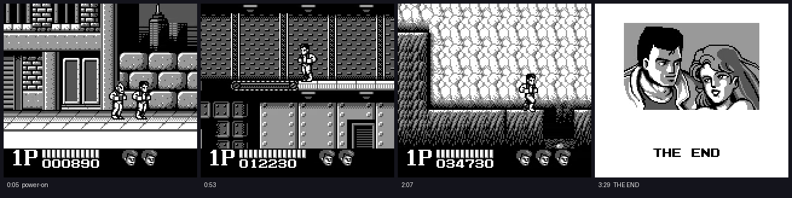

# Distilled approach: a decision-model teacher that beats Double Dragon, and its distillation

The original approach in [`../app/`](../app/) trains a PPO agent from pixels and shaped rewards. After about a month,
1 run in 100 cleared mission 1. This directory takes a different route:

1. **A teacher plays the game.** At every step, the same observation the PPO agent sees goes to **DiffusionGemma**
   (a diffusion LLM served by vLLM), which picks one of the 9 buttons. Around it sit exact game-state readers,
   frame-level reflexes and search-based planners. There is no learner and no gradient updates.
2. **Its decisions are distilled into a small, fast student** (behaviour cloning into the PPO network, then PPO
   fine-tuning, with DAgger as the next step), so the game can eventually be played without a 26B model in the loop.

**Result: the teacher plays Double Dragon (Game Boy) from power-on to THE END.**

[](../media/double-dragon-power-on-to-the-end.mp4)

▶ **[Watch the full run (3 min 32 s)](../media/double-dragon-power-on-to-the-end.mp4)**

How the video was made:
- **One continuous emulator timeline, joined from two runs.** Part 1 (`fullgamevid8`) plays from power-on to the
  mission-4 maze ledge. Part 2 (`fullgamevid9`) continues from the exact save state where part 1 stopped; the splice
  frame was checked to be identical.
- **Part 1 used 3 rewinds:** the rewind-on-death teacher mode (`DD_REWIND=1`) restores a recent state instead of
  losing a life.
- **Part 2 used no rewinds.** It runs through the sealed room, hall, skull room, lock room, throne room and the gunman
  boss to GAME COMPLETE (step 2947, 4 lives left), then the credits and THE END.

## How the teacher works

Each step of [`run-decision-dd.py`](run-decision-dd.py) runs these stages, top to bottom; the first that applies
decides the action:

| Stage | Module | What it does |
|---|---|---|
| Game state | [`radar.py`](radar.py), [`progress.py`](progress.py) | Reads sprites from the OAM table and HP and map-chunk ids from RAM, so decisions use exact geometry instead of guessing from pixels. The map-chunk byte gives a free, exact progress measure. |
| Reflexes | [`reflex.py`](reflex.py) | Frame-level actions the model can't time with about 1 s of latency: conveyor-belt jump kicks, ladder alignment, pit and ledge vetoes, the stepping stones, heavy fights. |
| Planners | [`fight_planner.py`](fight_planner.py), [`nav_planner.py`](nav_planner.py), [`hop_planner.py`](hop_planner.py) | The emulator is deterministic from a save state, so hard situations become searches. Fights: beam search over actions with enemy HP read from RAM. Stalls: breadth-first search for a new map area. Pillar hops: try the launch on the live emulator and keep one that lands. Then restore and replay the winner. |
| Decision model | [`decision_client.py`](decision_client.py) | Everything else: one choice question ("which button next?") to DiffusionGemma-26B-A4B via the structured `/v1/systemone` endpoint, round-robined across replicas. |
| Fallback | [`advice_policy.py`](advice_policy.py) | If the model is unreachable, follow the runner's own text advice, the same instruction the model reads. This replaced a random fallback that kept falling through belt gaps. |

The full story is in [`docs/JOURNAL.md`](docs/JOURNAL.md): about 150 iterations, every wall, and what got through it.
It covers mission 2's conveyor belts, mission 3's river and stones, the mission-4 maze, the scripted second boss and
the chunk-84 soft-lock.

## Distillation: where it stands

- **Traces:** every teacher step stores the full 9-way probability vector alongside the observation.
- **Behaviour cloning** ([`bc_pretrain.py`](bc_pretrain.py)): KL divergence to the teacher's soft targets, trained into
  `app/custom_cnn_model.py`'s network. On 87 traces (108k frames) it reached **65% agreement** with the teacher's top
  action.
- **PPO warm start** ([`eval_ppo.py`](eval_ppo.py)): starting PPO from those weights and fine-tuning for 78 minutes
  gave a policy that **mostly stands and trades punches**. From the mission-1 start it covered 240 px, against the
  teacher's 1000–1300 px. **The distilled student is not yet a good player.**
- **Next step: DAgger,** with the planners and the rewind teacher as the labeller. The student plays and the teacher
  labels the states the student actually reaches. Then PPO fine-tuning on the RAM-based rewards. The follow-on
  robotics project, [hello-chris-robot-kuberay](https://github.com/cnuland/hello-chris-robot-kuberay), used this
  recipe (a DiffusionGemma teacher, then DAgger, then PPO) end to end.

## Layout

```
distilled/
  run-decision-dd.py      teacher runner (Ray actors, one emulator each; --local for in-process)
  radar.py progress.py    exact game state from OAM and RAM
  reflex.py               frame-level reflexes and vetoes
  fight_planner.py nav_planner.py hop_planner.py   emulator-search planners
  decision_client.py      DiffusionGemma /v1/systemone client (round-robin, retries)
  advice_policy.py        rule-based fallback
  bc_pretrain.py eval_ppo.py analyze_runs.py       distillation and evaluation
  _paths.py               puts ../app on the import path; finds the ROM and states
  tests/                  fake decision server, latency bench, mission-2 explorer
  k8s/                    DiffusionGemma on vLLM (dgemma/, aro/ for T4 or A10), RayCluster + submit scripts (ray/),
                          ROSA and ARO cluster bring-up, OpenShift AI install
  docs/JOURNAL.md         the full research log
```

`app/ddenv.py` (the PyBoy environment) and `app/custom_cnn_model.py` are shared with the PPO approach and stay in
`app/`.

## Running it

**ROM and save states are not in git.** Put your own `dd.gb` and the `.state` files in `app/ignored/`, or point
`DD_ASSETS_DIR` at them.

Locally, with a fake decision server (no GPU):

```bash
python3.11 -m venv app/venv && app/venv/bin/pip install -r app/requirements.txt
app/venv/bin/python distilled/tests/fake_decision_server.py 18011 &
DGEMMA_URL=http://127.0.0.1:18011 S3_BUCKET_NAME= \
  app/venv/bin/python distilled/run-decision-dd.py --local --num-envs 1 --max-steps 120 --run-tag smoke
```

With the real model and the planners at scale (OpenShift; the DiffusionGemma pods need GPUs):

```bash
distilled/k8s/aro/bringup.sh                 # or distilled/k8s/rosa/*: cluster, GPU nodes, GPU operator
distilled/k8s/dgemma/deploy.sh               # DiffusionGemma on vLLM + the structured decision server
oc apply -f distilled/k8s/ray/raycluster-decision.yaml
distilled/k8s/ray/submit-decision-run.sh --num-envs 100 --episodes-per-env 1 --max-steps 2048
```

- **T4 GPUs:** `distilled/k8s/aro/dgemma-t4.yaml` carries the vLLM patches they need (single-stage Triton attention
  with 16-token tiles, PyTorch top-k/top-p sampling, `CUDA_MODULE_LOADING=EAGER`).
- **MinIO credentials:** the submit scripts read them from the cluster Secret `minio/minio-root-user`, or from
  `S3_ACCESS_KEY_ID` / `S3_SECRET_ACCESS_KEY`. They are never hard-coded.
